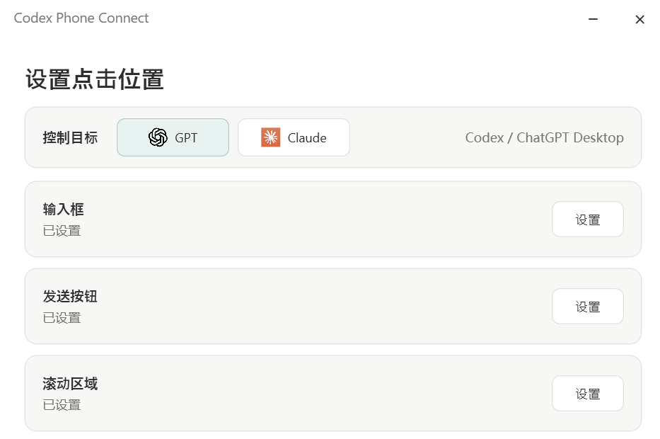
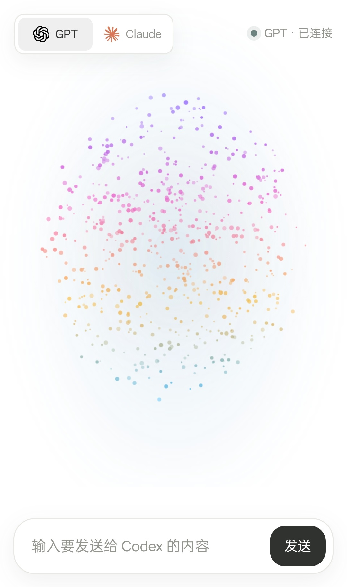
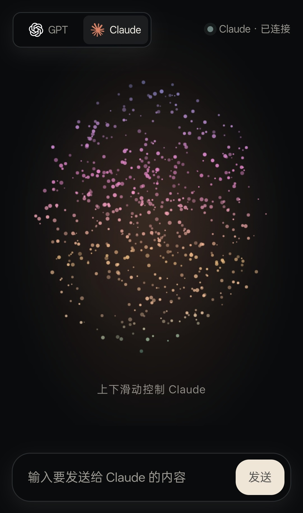
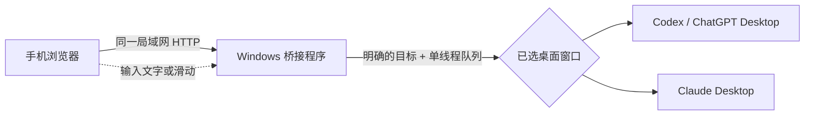

<div align="center">
  <h1>手机控制 Codex 与 Claude Desktop</h1>
  <p><strong>把手机变成桌面 AI 的遥控器。</strong></p>
  <p>局域网直连，在手机上发送消息、滑动控制电脑上的聊天窗口。</p>
  <p>
    <a href="https://github.com/L3n3L/codex-phone-connect/releases/latest"><strong>下载 Windows 版</strong></a>
    ·
    <a href="#快速开始">快速开始</a>
    ·
    <a href="https://github.com/L3n3L/codex-phone-connect/issues/new/choose">反馈问题</a>
  </p>
  <p>
    <a href="https://github.com/L3n3L/codex-phone-connect/releases/latest"></a>
    <a href="https://github.com/L3n3L/codex-phone-connect/actions/workflows/build.yml"></a>
    
    
  </p>
</div>

**Codex Phone Connect** 是一个 Windows 桌面桥接工具：手机浏览器通过同一局域网连接电脑，把输入和滑动操作转交给已校准的 **Codex / ChatGPT Desktop** 或 **Claude Desktop** 窗口。手机负责遥控，回复仍显示在电脑上的原生应用里。

> 不读取聊天历史，不创建或切换会话，不经过云端中继。消息只用于局域网内的桌面输入。

## 实机界面

电脑端分别校准目标应用的输入框、发送按钮和滚动区域；手机端可切换控制 GPT 或 Claude，并通过粒子区域遥控桌面滚动。

<p align="center">
  
</p>

<table>
  <tr>
    <td align="center"><strong>GPT · 浅色模式</strong><br></td>
    <td align="center"><strong>Claude · 深色模式</strong><br></td>
  </tr>
</table>

## 它能做什么

- **手机发消息**：在手机输入文字，发送到当前选中的桌面智能体。
- **手机控滚动**：在手机的粒子交互区域上下滑，电脑上的聊天窗口同步滚动；手机不需要展示聊天记录。
- **GPT / Claude 分别校准**：每个目标各自保存输入框、发送按钮和滚动区域的位置。
- **窗口变化更稳**：校准点按目标窗口客户区比例保存，不依赖屏幕绝对坐标。
- **请求目标明确**：发送或滚动请求带上目标标识，再进入单线程队列；切换目标不会改写已排队请求的目标。
- **日志便于排查**：按天记录服务运行信息，默认不记录消息正文。

## 工作方式



电脑端负责定位并操作目标桌面窗口；手机端只提供控制界面。这个项目**不是**会话同步器：它不会读取 Codex Thread、Claude 对话记录，也不会把桌面回复传回手机。

## 快速开始

### 下载使用

1. 从 [最新 Windows x64 版本](https://github.com/L3n3L/codex-phone-connect/releases/latest)下载并解压。
2. 运行 `CodexPhoneConnect.exe`。发布包自包含 .NET 运行时，无需单独安装 .NET。
3. 确保手机和电脑可以在局域网内互相访问，用手机扫描桌面窗口中的二维码。
4. 在电脑端选择 GPT 或 Claude，依次设置该目标的输入框、发送按钮、滚动区域，然后保存。
5. 在手机页面选择同一个目标，发送消息或滑动粒子区域。

### 从源码运行

需要 Windows 10/11 和 .NET 8 SDK：

```powershell
dotnet build .\CodexPhoneConnect.Desktop.csproj
dotnet run --project .\CodexPhoneConnect.Desktop.csproj
```

### 校准小提示

- 开始校准后，点击目标桌面应用中的对应位置；桥接窗口会暂时隐藏。
- GPT 和 Claude 的三个位置分别保存，互不覆盖。
- 如果改变了应用布局、显示器或 Windows 缩放比例，重新校准对应目标。

## 环境与网络

- Windows 10 / 11 x64
- Codex / ChatGPT Desktop 或 Claude Desktop
- 手机与电脑连接到允许设备互访的网络
- 默认端口：`8787`

如果手机打不开地址，先关闭手机 VPN / 移动数据，避开访客 Wi-Fi，并检查路由器是否启用了 AP/客户端隔离。**不要把 8787 端口直接暴露到公网**；本地桥接服务面向可信局域网，不提供公网中继或账号认证。

## 隐私与安全边界

- 手机页面由电脑上的程序本地提供，控制请求直接发往电脑。
- 桥接程序通过剪贴板粘贴并点击桌面应用的发送位置；它不调用模型 API。
- 程序不会读取、保存或同步目标应用中的对话历史。
- 服务日志默认记录运行状态、目标和任务元数据，不记录消息正文。
- 局域网内的其他设备可能访问服务；请只在可信网络中运行，不要配置公网端口转发。

## 常见问题

<details>
  <summary>手机和电脑连着同一个 Wi-Fi，仍然打不开？</summary>

检查 VPN 的“阻止局域网连接”、访客网络、路由器 AP 隔离和 Windows 防火墙。可以先让两台设备连接同一个手机热点，判断是不是原 Wi-Fi 的设备隔离导致。
</details>

<details>
  <summary>发送或滚动位置不对？</summary>

确认电脑端当前选中的目标与手机端一致，并重新校准对应窗口的输入框、发送按钮和滚动区域。改变显示缩放或窗口内容布局后尤其需要重新校准。
</details>

<details>
  <summary>换到另一个桌面目标，会影响已经发送的操作吗？</summary>

不会。每条新请求在进入队列时确定目标；后续切换只影响之后的新请求。
</details>

## 技术栈

`C#` · `.NET 8` · `WPF` · `ASP.NET Core Minimal API` · `HTTP` · `QRCoder`

项目采用适配器与目标目录分层：桌面目标识别、校准配置、输入注入、手机页面和任务队列各自负责独立职责。当前明确支持 Codex / ChatGPT Desktop 与 Claude Desktop；新增目标需要实现并验证对应的窗口识别和输入适配，不是单纯增加配置项。

## 反馈与参与

遇到问题或有功能建议，欢迎通过 [Issues](https://github.com/L3n3L/codex-phone-connect/issues/new/choose) 提交。报告问题时请附上 Windows 版本、软件版本、复现步骤和相关日志，并先移除 IP 地址、用户名等个人信息。

如果这个工具正好解决了你的使用痛点，欢迎给仓库点个 **Star**，也欢迎分享给同样需要用手机遥控桌面 AI 的人。

## 项目状态与许可

项目仍在迭代，当前版本和更新内容请查看[最新 Release](https://github.com/L3n3L/codex-phone-connect/releases)。项目原创代码与文档采用 [MIT License](LICENSE)，版权归 **L3n3L** 所有。

第三方依赖、品牌名称与商标不包含在本项目授权范围内，仍受各自权利人的许可与条款约束。

Codex Phone Connect 是独立社区项目，与 OpenAI、Anthropic 或其产品无隶属关系。产品名称和商标归各自权利人所有。

---

<details>
  <summary>English</summary>

**Codex Phone Connect** is a Windows WPF bridge that lets your phone send text and control scrolling in Codex / ChatGPT Desktop or Claude Desktop over a local network.

- Calibrate the input, send, and scroll points for each desktop target.
- Phone requests carry an explicit target and run through a single queue.
- No cloud relay, conversation-history access, or reply sync to the phone.
- Windows 10/11 x64. Download the [latest release](https://github.com/L3n3L/codex-phone-connect/releases/latest).
- Do not expose the default port `8787` to the public internet.

</details>
